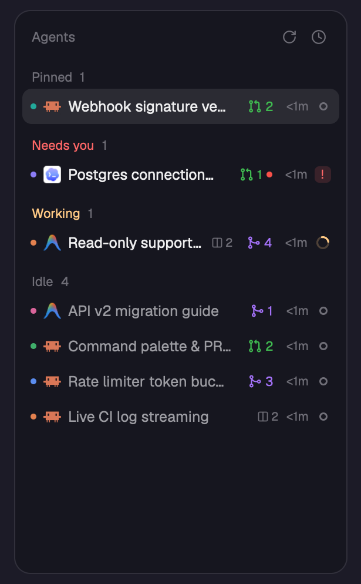

# Agent PRs (`vantage-agents`)



Standalone **Agents** sidebar mod for Herdr App that shows real task titles for **Claude Code** and **Antigravity (`agy`)**, split-pane counts, and Claude Code-style GitHub PR status badges (`#3fb950` green = open, `#a371f7` purple = all merged, `#f85149` red dot = CI failing) with a clickable PR list popover.

## Install

```text
Read ~/.config/herdr-app/AGENTS.md, then add this mod: https://github.com/felixsjoberg/herdr-mods/tree/main/agent-prs
```

## What it runs

Runs `mods/vantage-agents/sync-agents-meta.py` (off the UI thread every 45s while active and after turns complete) using `hc`, `lsof`, read-only `git`, read-only local session files (`~/.claude/projects/*/*.jsonl`, `~/.gemini/antigravity-cli/`), and a single batched `gh api graphql` call. Clicking a PR runs `open <url>`.

## Integration

Point your layout's `agents` block to `"mod": "vantage-agents"`. Results are also published to `shared("vantage.agentsMeta")` for companion Spaces/Tabs mods.
