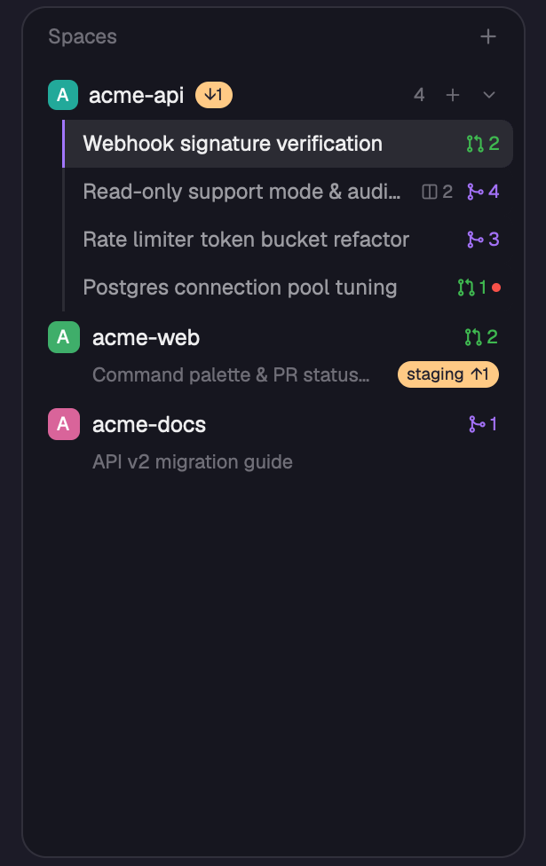

# Repo Spaces (`vantage-spaces`)



Standalone **Spaces** sidebar mod for Herdr App that groups multiple spaces in the same repository under a single collapsible repo header, displays task subtitles, split-pane (`◫ N`) and multi-tab (`Nt`) indicators, rolled-up PR badges (when paired with `vantage-agents`), and a `+` button to add a tab inside that repo.

## Install

```text
Read ~/.config/herdr-app/AGENTS.md, then add this mod: https://github.com/felixsjoberg/herdr-mods/tree/main/repo-spaces
```

## What it runs

Runs read-only `git` (`status --porcelain=v2 --branch`, `rev-parse`) and `hc machine ls --json`. Reads `shared("vantage.agentsMeta")` when `vantage-agents` is installed.

## Integration

Point your layout's `spaces` block to `"mod": "vantage-spaces"`.
